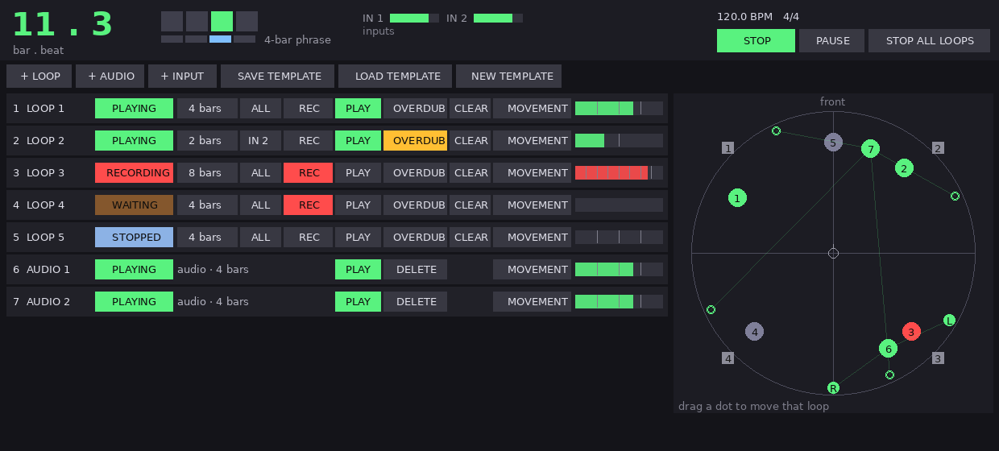
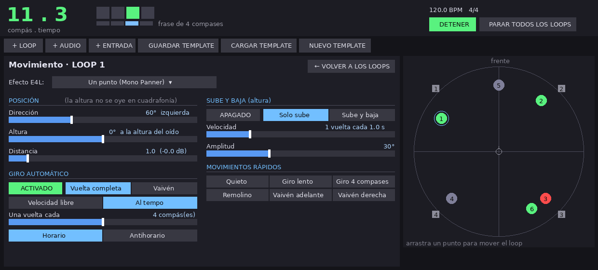

# Enveloppe Live Reaper

Port de **[Envelop for Live (E4L)](https://github.com/EnvelopSound/EnvelopForLive)**, el kit de mezcla
espacial en ambisonics de Envelop para Ableton Live, a **REAPER**.

Los dispositivos Max for Live (`.amxd`) de E4L solo funcionan dentro de Ableton, así que aquí se
reescriben como **JSFX**, el formato de plugin nativo de REAPER. No hay que compilar nada, funcionan
en Windows, macOS y Linux, y todos sus parámetros se pueden automatizar con envolventes de REAPER.

Formato interno: **ambisonics de 3.er orden, 16 canales, ambiX (ACN / SN3D)**, el mismo que usa E4L
y compatible con el IEM Plugin Suite, SPARTA y otros.

## Estado del port

| Dispositivo E4L | REAPER | Estado |
|---|---|---|
| E4L Source Panner | `E4L Source Panner.jsfx` | ✅ Mono/Estéreo, Polar/XYZ, apertura, distancia |
| E4L Mono Panner | `E4L Mono Panner.jsfx` | ✅ con LFO de azimut y elevación |
| E4L Stereo Panner | `E4L Stereo Panner.jsfx` | ✅ con LFO de azimut, elevación y apertura |
| E4L Quad Panner | `E4L Quad Panner.jsfx` | ✅ 4 entradas, modos de apertura LR / X / W, 4 LFO |
| E4L Multi-Panner | `E4L Multi-Panner.jsfx` | ✅ 16 entradas con posición propia, LFO de azimut, elevación y escala |
| E4L Master Bus (decodificadores) | `E4L Master Bus.jsfx` | ✅ Binaural 3.er orden, Estéreo, Quad, Octo, 5.1, 7.1, 5.1.2, 7.1.4, AmbiX |
| — (nuevo) | `E4L Looper.jsfx` | ✅ Looper en vivo sincronizado al compás, estilo Ableton |
| — (nuevo) | `E4L Sub Out.jsfx` | ✅ Va en el master de REAPER: manda la suma de todo a la salida del sub |
| Spinner, HOA Transform, Multi-Delay, Spatial Slicer, Brownian Delay… | | ⏳ pendientes |

Lo que no se porta porque REAPER ya lo hace: el ruteo automático entre pistas (se usan envíos de
16 canales; el script de abajo los crea), la grabación y exportación (render de REAPER) y los
medidores (los de REAPER muestran los 16 canales).

## Instalación

1. En REAPER: **Options › Show REAPER resource path in explorer/finder**.
2. Copia las carpetas de este repositorio dentro de esa carpeta de recursos, combinándolas con
   las que ya existen:
   - `Effects/E4L` → `<recursos>/Effects/E4L` (los plugins)
   - `Data/E4L` → `<recursos>/Data/E4L` (los filtros HRTF del decodificador binaural)
   - `Scripts/E4L` → `<recursos>/Scripts/E4L` (opcional, script de configuración)
3. En REAPER: abre el navegador de FX y pulsa **F5** para refrescar. Aparecerán como `JS: E4L …`.

### Actualizar

Ejecuta `Scripts/E4L/E4L - Update from GitHub.lua` (en Mac usa curl y unzip; en Windows, PowerShell).
Descarga la última versión de `main` y reemplaza solo las carpetas `Effects/E4L`, `Data/E4L` y
`Scripts/E4L` de la carpeta de recursos de REAPER.

## Uso rápido

**Automático:** en **Actions › Show action list › New action › Load ReaScript…**, carga
`Scripts/E4L/E4L - Setup session.lua`. Selecciona las pistas que quieras espacializar y ejecútalo:

- crea (o reutiliza) la pista **"E4L Master"** de 16 canales con `E4L Master Bus`;
- pone cada pista seleccionada a 16 canales, le añade el paneador, desactiva su envío al master
  y crea un envío de 16 canales hacia "E4L Master".

**Manual** (lo mismo que hace E4L en Live):

1. **Pista "E4L Master":** botón *Route* → *Track channels: 16*. Añade `E4L Master Bus`.
   Para auriculares, deja *Decoder = Binaural (3rd-order)*.
2. **Cada fuente:** *Track channels: 16*, añade `E4L Stereo Panner` (o Mono/Source), **desactiva
   "Master send"** y añade un envío a "E4L Master" con *Audio: 1-16 → 1-16*.

## Looper en vivo (estilo Ableton)

Para componer en vivo con un sinte (por ejemplo, uno analógico): lo escuchas solo en los auriculares,
grabas loops de N compases que entran justo en el siguiente compás y cada loop suena espacializado
en la cuadrafonía.

1. Ejecuta `Scripts/E4L/E4L - Live Looper template.lua`. Crea:
   - **SYNTH IN:** la entrada del sinte, monitoreada y enviada solo a los auriculares (por defecto, salidas 5-6);
   - **LOOP 1…N:** `E4L Looper` + paneador E4L en cada pista;
   - **E4L Master:** decodifica en Quad hacia las salidas 1-4;
   - **CUE (auriculares):** copia binaural de los loops para los auriculares.
2. Pulsa PLAY en REAPER. En el `E4L Looper` de una pista, elige *Length* y pulsa **REC**: graba en
   el siguiente compás y al terminar pasa solo a **PLAY**. También tiene **OVERDUB** y **CLEAR**,
   y todo se puede asignar a MIDI (*Param › Learn*).
3. Sub: el script pone `E4L Sub Out` en el master de REAPER, así que todo lo que llega al master
   también sale por la salida del sub (por defecto, la 5). Para un proyecto existente, usa
   `Scripts/E4L/E4L - Add sub to master.lua`.
4. **Panel en vivo:** `Scripts/E4L/E4L - Live Panel.lua` abre una sola ventana, acoplable a
   REAPER, con el compás y el tiempo en grande y todos los loops (GRABAR / SONAR / CAPA / BORRAR,
   largo y posición). También muestra la sala con un punto por loop, que se arrastra para moverlo.
   El botón **MOVIMIENTO** de cada loop abre su editor: el menú del efecto E4L, la posición, el giro
   automático (libre o al tempo), sube y baja, la apertura estéreo y movimientos rápidos.
   Teclas: Espacio = iniciar/detener, 1-9 = grabar, 0 = parar todos, Esc = cerrar el editor.

   
   
5. Scripts de control: `E4L - Loop REC (selected tracks)`, `E4L - Loop PLAY-STOP (selected tracks)`
   y `E4L - Loops STOP all`.

Los loops viven en la memoria del plugin y no se guardan con el proyecto. Para conservar una
sesión, expórtala con *Render*. La guía completa está en `docs/Guia_E4L_REAPER_Cuadrafonia.pdf`.

## Automatismos (LFO de E4L)

Los paneadores Mono, Stereo, Quad y Multi incluyen los LFO de E4L con los mismos parámetros:

| Parámetro | Qué hace |
|---|---|
| **Azimuth LFO Mode** | *Cycle*: giro completo de 360° · *Sin*: oscila ± *Depth* |
| **Elevation LFO Polarity** | *Unipolar*: de 0 a *Depth* hacia arriba · *Bipolar*: ± *Depth* |
| **Time Mode** | *Freq*: Hz × *Rate* (Rate negativo = sentido contrario) · *Sync*: sincronizado al tempo |
| **Sync (bars)** | 1/4, 1/2, 1, 2, 3, 4, 6, 8, 16, 32, 64 compases por ciclo |
| **Direction** | Clockwise / Counter (en modo Sync) |
| **Azimuth/Elevation Spread LFO** | (Stereo y Quad) abre y cierra la imagen |
| **Azimuth/Elevation Scale LFO** | (Multi-Panner) expande y contrae todo el grupo de entradas; *Depth* de −1 a 1 |

### Quad Panner

Entradas: 1 delantera izq., 2 delantera der., 3 trasera izq., 4 trasera der. (canales 1-4 de la pista).
*Azimuth Spread Mode*, igual que en E4L:

- **LR:** cuadrado, con el par delantero a azimut ∓ apertura/2 y el trasero a azimut+180 ± apertura/2.
- **X:** como LR, pero con el par trasero cruzado (diagonales).
- **W:** abanico centrado en el azimut. Con apertura 90 queda un cuadrado; con 180, todo atrás; con 0, todo al frente.

### Multi-Panner

Paneo de hasta 16 canales de la pista (por ejemplo, un multipista o un sinte multisalida). Cada
entrada tiene *Active*, *Azimuth*, *Elevation* y *Radius* propios, relativos al grupo:

```
azimut(n)    = Azimuth   + Input n Azimuth   × Azimuth Scale
elevación(n) = Elevation + Input n Elevation × Elevation Scale
radio(n)     = máx(0, Radius + Input n Radius × Radius Scale)
```

Por defecto todas las entradas están en el centro (0°), como en E4L. Distribúyelas con el
*Azimuth* de cada entrada y usa *Azimuth Scale* (y su LFO) para abrir o cerrar el conjunto.

En modo *Sync*, mientras REAPER reproduce, la fase del LFO se engancha a la posición del proyecto
(como `phasor~ @lock 1` en E4L). Así, el movimiento es idéntico en cada reproducción y en el render.
Además, cualquier parámetro se puede automatizar con envolventes o con la **Parameter
Modulation** de REAPER (LFO, seguidor de envolvente, enlace entre parámetros).

## Convenciones (igual que E4L)

- **Azimut:** 0 = frente, +90 = derecha, −90 = izquierda, ±180 = detrás.
- **Elevación:** 0 = horizonte, +90 = arriba.
- **Distancia:** `distancia = Radius × Range`. Dentro de 1 unidad la fuente se vuelve omnidireccional;
  fuera, se atenúa 1,5 dB por unidad. Con los valores por defecto de E4L (Radius 1, Range 10)
  la fuente suena 13,5 dB más baja; para el nivel completo usa Radius = 1/Range.
- **XYZ** (Source Panner): X = derecha, Y = frente, Z = arriba.
- **Apertura estéreo** (como en E4L): izquierda = azimut − apertura y elevación + apertura de elevación;
  derecha, al revés.

## Diferencias conocidas con E4L

- E4L usa los objetos ICST Ambisonics, cuyo código no está disponible. Este port implementa la misma
  matemática (codificación SN3D/ACN y decodificación por muestreo con ponderación por orden), pero los
  niveles absolutos de los decodificadores están normalizados por energía y pueden diferir algo de E4L.
- *Order Weighting*: E4L usa `ambidecode~ @type 2`. Aquí es "In-phase (E4L)" por defecto, y además
  puedes elegir *max-rE* (más preciso) o *Basic*.
- Binaural: las mismas 25 HRTF de IRCAM Listen (sujeto 1052) que E4L, en sus direcciones exactas.
  Se precalculan como 16 filtros FIR estéreo (`tools/make_binaural_filters.py`) y tienen 512 muestras de
  latencia (1024 a 88,2/96 kHz), que REAPER compensa automáticamente (PDC).
- Los LFO se calculan cada 32 muestras con interpolación lineal (E4L lo hace cada 10 ms).
- No se incluyen OSC ni el control de luces LED de Envelop.

## Pruebas

`tests/run_tests.sh` compila [ysfx](https://github.com/jpcima/ysfx), un intérprete libre de JSFX, y
comprueba los plugins sin necesidad de REAPER: codificación, LFO, sincronización al tempo y
decodificadores.

## Licencia y créditos

**GNU GPL v2 o posterior** (ver `LICENSE`), la misma que Envelop for Live, porque este proyecto es
una obra derivada de E4L.

- Envelop for Live © Envelop (envelop.us), Mark C. Slee y colaboradores. Si E4L te es útil,
  considera [apoyar a Envelop](https://envelop.us/memberships).
- HRTF: base de datos IRCAM Listen (sujeto 1052), redistribuida en E4L.
- Codificación y decodificación inspiradas en las herramientas ICST Ambisonics (ZHdK).
